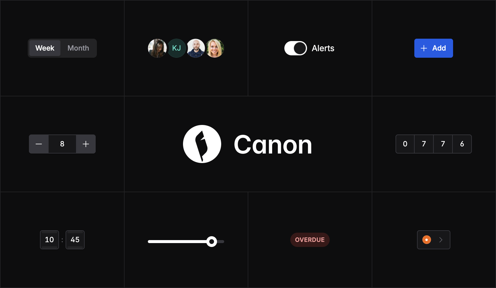

# Canon

Component library for internal tools: tables, forms, records.

**The markup is the contract.**

[Documentation](https://recepkutuk.github.io/canon/) · [npm](https://www.npmjs.com/package/canon-ui)

Canon builds tables, forms and dialogs once, in plain HTML: the browser does the work, a theme decides the look, and the markup outlives both.


## Start

Two lines, then the markup each component's page shows. There's no build step, so take them from a CDN:

```html
<link rel="stylesheet" href="https://cdn.jsdelivr.net/npm/canon-ui@0.2.0/css/canon/canon.css">
<script src="https://cdn.jsdelivr.net/npm/canon-ui@0.2.0/js/canon.js" defer></script>
```

Or install the package:

```bash
npm i canon-ui
```

Then link the files from `node_modules/canon-ui/`, or serve them with your app:

```html
<link rel="stylesheet" href="node_modules/canon-ui/css/canon/canon.css">
<script src="node_modules/canon-ui/js/canon.js" defer></script>
```

Or, if your app bundles its files, the same two:

```js
import "canon-ui/css/canon/canon.css";
import "canon-ui";
```

A primary action:

```html
<button type="button" class="canon-button" data-emphasis="high">
  <span class="canon-icon" data-icon="plus" aria-hidden="true"></span>
  <span class="canon-button-label">New invoice</span>
</button>
```

Optionally, to ship only the components your app uses, build Canon with just those. This writes `canon.css`, `canon.core.css` and `canon.js` to `canon/`, or to the folder `--out` names:

```bash
npx canon-ui build --only core,data,date
```

`npx canon-ui build --list` shows the bundles and the components.

## Why Canon

- **Write it once, keep it.** A `<button>` written today still works in ten years. Canon is unopinionated about your stack and your look: it's markup, so it works with whatever renders it and outlives the framework of the moment.
- **Accessible by nature.** This is where Canon is opinionated: names, roles, focus and keys are part of each component's markup. No one has to remember them, and no theme can lose them.
- **Less JavaScript every year.** Browsers keep doing more on their own. Canon uses what they do, and its script steps back as they catch up.
- **Works the way you expect.** A table should read like a table, a form should never lose what was typed, and the keyboard should always work.

## You say what it is. The theme says how it looks.

A button becomes what its attributes say. The theme draws it.

```html
<!-- A button -->
<button type="button" class="canon-button">
  <span class="canon-button-label">Cancel</span>
</button>

<!-- The main action -->
<button type="button" class="canon-button" data-emphasis="high">
  <span class="canon-button-label">Save</span>
</button>

<!-- A button that opens a menu: the theme draws its chevron -->
<button type="button" class="canon-button" aria-haspopup="menu">
  <span class="canon-button-label">Export</span>
</button>

<!-- Working: the theme draws a spinner -->
<button type="button" class="canon-button" data-emphasis="high" aria-busy="true" aria-disabled="true">
  <span class="canon-button-label">Saving…</span>
</button>
```

The same markup looks right in each of Canon's six themes: Canon's own, and looks inspired by Carbon, Material, Fluent, Ant Design and Bootstrap.

## Components

- **Layout:** App Shell, Page Header, Section, Separator, Sidebar, Split Pane, Stack, Cluster and Grid, Toolbar, Top Bar
- **Actions:** Button, Button Group, Link, Segmented Control, Split Button, Toggle Chip
- **Forms:** Checkbox, Color Picker, Combobox, Date family, Field, Fieldset, Form Layout, Form Repeater, Input OTP, Label, Number Input, Password, Radio, Range Slider, Rich Text, Save Bar, Select, Slider, Swatches, Switch, Text Input, Textarea, Time
- **Data display:** Accordion, Avatar, Avatar Group, Card, Code Block, Data Table, Description List, Empty State, Filter Bar, Kbd, Stat, Status Indicator, Table, Tag
- **Navigation:** Breadcrumb, Command Palette, Menubar, Nav List, Pagination, Tabs
- **Overlays:** Dialog, Drawer, Menu, Popover, Tooltip
- **Feedback:** Alert, Banner, Skeleton, Spinner, Toast
- **Patterns:** List → Detail → Edit, Master–Detail, Settings Page, Sign-in Page

## 67 of 68 components work without JavaScript

Each component's specification gives its tier, from T0 to T3: what it does with HTML and CSS alone, and what canon.js adds. When a script doesn't load, the page still works.

| Tier | Components | What it needs |
| --- | ---: | --- |
| T0 | 49 | HTML and CSS |
| T1 | 7 | Browser features |
| T2 | 11 | Better with JavaScript |
| T3 | 1 | Needs JavaScript |

## Who it's for

Canon is for teams with:

- **A back end and no front-end team.** Django, Rails, Laravel and Go templates already write HTML, and that's all Canon needs: two lines in the page, no build step, no client framework.
- **Several stacks.** A React app, a server-rendered admin and an old internal tool write the same elements and attributes, and get the same components.
- **A brand to follow, or several.** One stylesheet decides the look. A rebrand, a client's colors or a new design system is a new theme; the pages stay as they are.
- **Tools that must last years.** Plain HTML has no framework version to keep up with, and a script that fails to load doesn't take the screens with it.

## What Canon leaves to others, on purpose.

Canon is not:

- **A JavaScript component library.** There's nothing to import or call, and no build step. Your framework or server renders the HTML.
- **Styled in the markup.** Markup says what a thing is (`data-intent`), never how it looks: no "outline", "rounded" or "blue".
- **An app framework.** No routing, data loading or state. canon.js keeps the interface honest; saving and fetching are your app's.
- **For marketing sites.** Tables, forms, records and dashboards. Hero sections and pricing tables are out of scope.

## Origins

The name comes from fiction, where canon is the body of work officially accepted as authoritative within a story's universe. Here, the markup is canon. Themes can retell it however they like, but what the markup says stays true in all of them.

In 2003, Dave Shea published [CSS Zen Garden](https://csszengarden.com/): one HTML document, and a gallery of designs that changed nothing but the stylesheet. Each looked like a different site, and the markup never moved.

Canon is an homage to that page. It asks the same of the things internal tools are made of: write a table, a form or a dialog once, then let a theme redraw all of it without touching a line of HTML.

## Documentation

**[Read the documentation](https://recepkutuk.github.io/canon/)**: a live example, a playground and the full specification for each component.

- [Introduction](https://recepkutuk.github.io/canon/reference/introduction.html)
- [Getting started](https://recepkutuk.github.io/canon/reference/getting-started.html)
- [Components](https://recepkutuk.github.io/canon/reference/components.html)
- [Themes](https://recepkutuk.github.io/canon/reference/themes.html)
- [Build](https://recepkutuk.github.io/canon/reference/build.html)

## License

Canon is released under the [MIT License](LICENSE). The icons and fonts it includes keep their own licenses: see [Third-party notices](THIRD-PARTY-NOTICES.md).
